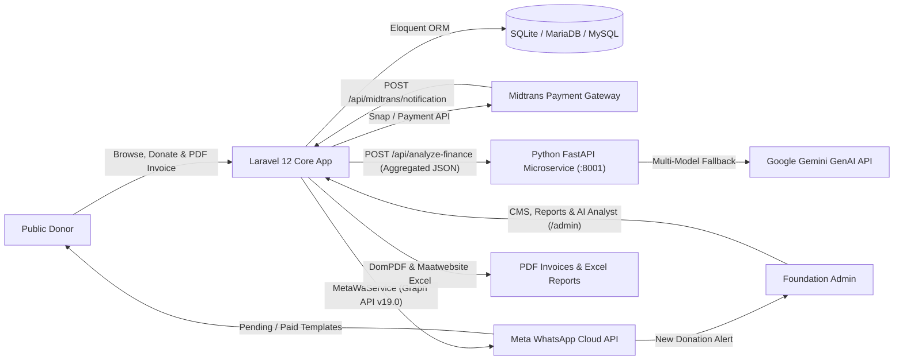
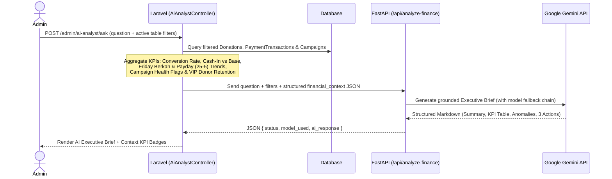
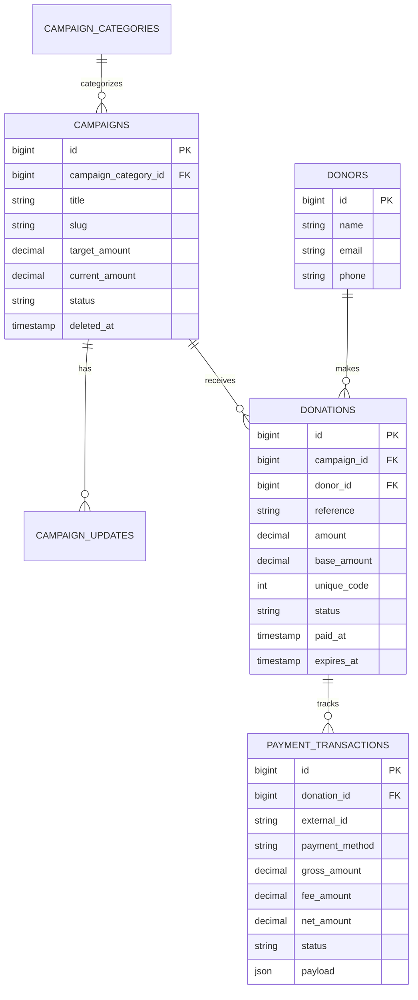

# DonasiFlow AI — Full-Stack Donation Platform & Gemini AI Financial Analyst


> **DonasiFlow Nusantara** is an end-to-end crowdfunding, donation management, and **AI-powered financial analytics** platform combining a **Laravel 12** core web application with an independent **Python (FastAPI) + Google Gemini** analytics microservice.

---

## Business Problem & Engineering Highlights

Non-profit foundations often struggle with fragmented donation records, manual payment verification, delayed donor confirmations, and time-consuming monthly financial analysis. **DonasiFlow AI** solves this end-to-end:

- **AI Financial & Fundraising Analyst (`Laravel -> FastAPI -> Gemini`):** Admins can ask natural-language questions on top of live filtered donation tables (`POST /admin/ai-analyst/ask`). Laravel computes deterministic financial aggregates on the fly and delegates executive brief generation to a decoupled **Python FastAPI** microservice.
- **Zero-Hallucination Prompting & Multi-Model Fallback:** The AI engine (`ai-service/ai_engine.py`) enforces strict grounding against Laravel's aggregated JSON context and implements automatic fallback across multiple Gemini models (`gemini-3.1-flash-lite` -> `gemini-3.8-flash` -> `gemini-2.5-flash-lite`) to stay resilient during API high-demand (`503`) events.
- **Dual Payment & Automated WhatsApp Flow:** Supports **Midtrans Payment Gateway** (with webhook status & fraud mapping) and **Manual Bank Transfer** (with automated unique transfer codes), paired with **Meta WhatsApp Cloud API (v19.0)** templates for pending instructions, admin alerts, and paid receipts.
- **Instant Reporting & Full Admin CMS:** Generates **PDF donor invoices** (`DomPDF`), **Excel financial exports** (`maatwebsite/excel`), and manages campaigns (with Soft Deletes), categories, updates, donors, banners, FAQs, testimonials, static pages, and WA reply templates.
- **Portfolio-Ready Deterministic Seeder & Test Suite:** Ships with `PortfolioAnalyticsSeeder` (multi-category campaigns, realistic historical transactions, Friday Berkah & Payday patterns) plus **6 PHPUnit Feature Test suites** covering public checkout, admin auth, manual donations, Excel export, and custom error pages.

---

## System Architecture



---

## AI Financial Analyst Sequence Flow



---

## Core Database Schema (ERD)



---

## Key Analytics Computed by `AiAnalystController`

Before calling the FastAPI AI service, Laravel computes deterministic, audit-grade business metrics so the LLM never invents numbers:

| Analytics Dimension | Metrics Computed |
| :--- | :--- |
| **Filtered Financial Scope** | Total & paid transactions, conversion rate %, total cash-in vs base donation vs unique-code surplus, average ticket size, anonymous donor count, and full status breakdown. |
| **Temporal Patterns** | Monthly cash-in trend (`Y-m`), **Friday Berkah** share of total paid donations, and **Payday Window (25th–5th)** share. |
| **Payment Channels** | Per-channel conversion rate %, expired/pending drop-off, gross amount, gateway fee, and net settled amount. |
| **Campaign Health Flags** | Automatic status flagging: `tercapai_100_persen`, `hampir_tercapai` (>= 80%), `kritis_mendesak_butuh_boost` (<= 14 days left & < 30% funded), and `normal`. |
| **Donor Segmentation** | Unique paid donors, repeat donor count & retention %, VIP donors (>= Rp 5.000.000), and Top 10 donors leaderboard. |

---

## Tech Stack

| Layer | Technologies |
| :--- | :--- |
| **Core Backend** | PHP 8.2+, Laravel 12, Eloquent ORM, OOP / MVC |
| **AI Microservice** | Python 3.10+, FastAPI, Uvicorn, Pydantic v2, Google GenAI SDK (`google-genai`) |
| **Frontend** | Blade Templates, Tailwind CSS v4, Vite 7, Axios |
| **Database** | SQLite (Local / Demo), MariaDB / MySQL (Production) |
| **Integrations** | Midtrans PHP SDK (`^2.6`), Meta WhatsApp Cloud API (`v19.0`) |
| **Reporting & Export** | `barryvdh/laravel-dompdf` (PDF Invoice), `maatwebsite/excel` (Excel Export) |
| **Testing & DevOps** | PHPUnit 11 (6 Feature Test suites), Laravel Pint, GitHub Actions SSH CI/CD |

---

## Local Installation & Setup

### 1. Clone & Install Laravel Dependencies

```bash
git clone https://github.com/isamsd26/donasiflow-ai.git
cd donasiflow-ai

cp .env.example .env
composer install
npm install
php artisan key:generate
```

*(Note: If PHP `ext-gd` is not enabled locally on Windows, run `composer install --ignore-platform-req=ext-gd`.)*

### 2. Migrate & Seed Portfolio Analytics Dataset

```bash
# Creates SQLite database (default in .env.example) and seeds realistic campaigns & historical donations
php artisan migrate --seed
php artisan storage:link
npm run build
```

Default local admin credentials (seeded in `local`/`testing` environments):
- **URL:** `http://127.0.0.1:8000/admin/login`
- **Email:** `admin@example.com`
- **Password:** `password`

### 3. Install & Run the Python FastAPI AI Microservice

Add your `GEMINI_API_KEY` to `.env`:

```env
AI_SERVICE_URL=http://127.0.0.1:8001
AI_SERVICE_TIMEOUT=45
GEMINI_API_KEY=your_gemini_api_key_here
```

Then install Python dependencies and start Uvicorn on port `8001`:

```bash
python -m venv .venv
# Windows PowerShell:
.\.venv\Scripts\Activate.ps1
# Linux / macOS:
# source .venv/bin/activate

pip install -r ai-service/requirements.txt
uvicorn main:app --app-dir ai-service --host 127.0.0.1 --port 8001 --reload
```

### 4. Run Laravel Server & Automated Tests

```bash
# Start Laravel dev server
php artisan serve

# Run PHPUnit feature test suite
php artisan test
```

---

## Author

**Isa Mas'ud** — Full-Stack Web & AI Automation Developer  
- Portfolio: [port.private-isa.my.id](https://port.private-isa.my.id)  
- LinkedIn: [linkedin.com/in/isamasud](https://linkedin.com/in/isamasud)  
- GitHub: [github.com/isamsd26](https://github.com/isamsd26)
